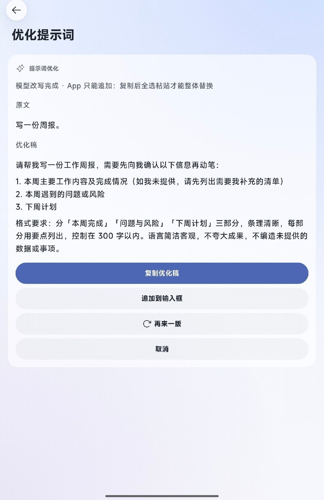
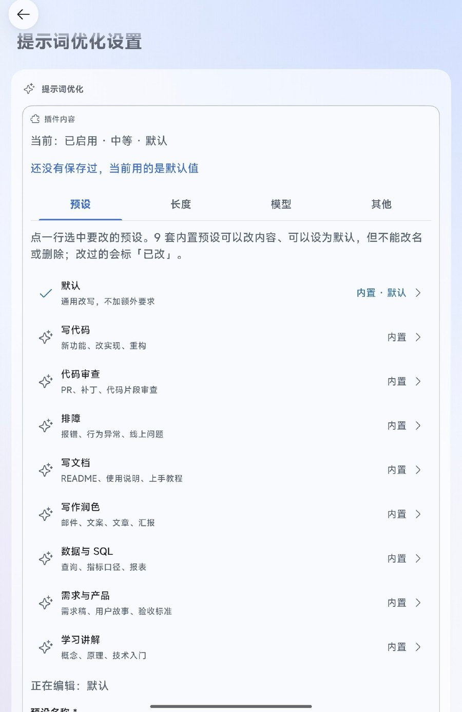
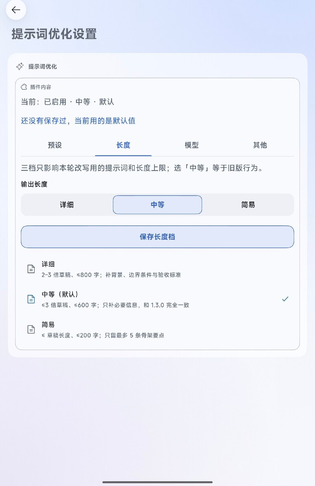
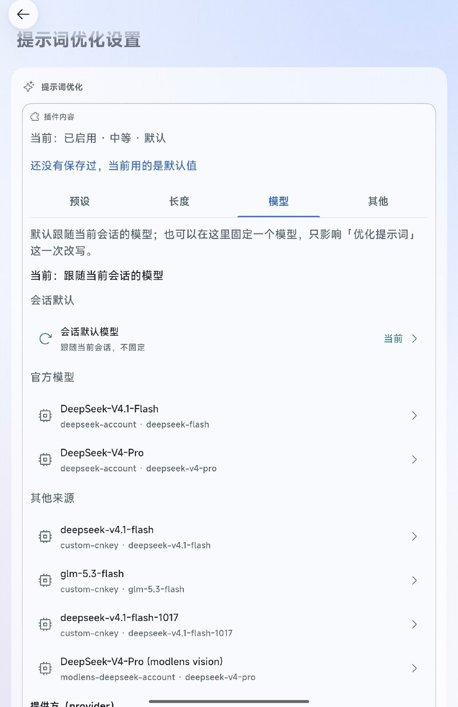
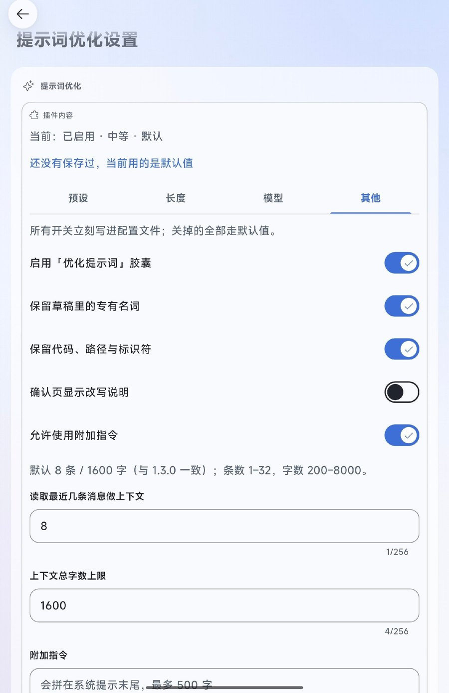

# ✦ One line in, a real prompt out · Prompt Polish


A capsule above the composer in the **dsh-go** Android app: don't send that rough draft yet — tap once and **the model of the current session** rewrites it into a sharper prompt, previewed in a confirmation sheet before anything reaches the input box.

No message is sent · your conversation is not modified · no extra network calls (only the model you already configured).

> Repository `dsh-go-prompt-polish` · plugin package `local-prompt-polish` (that is the install directory name).



## What it does

```
tap capsule → start job (≤3 s) → confirmation sheet opens
   · Polishing…
   · ready: draft + polished prompt + three buttons
        [Copy polished]  [Append to composer]  [Cancel]
```

| Button | Effect | Composer |
|---|---|---|
| **Copy polished** | clipboard only | untouched; long-press → Select all → Paste replaces it wholesale |
| Append to composer | `insert` | the app merges into the draft, so the original stays in front |
| Cancel | toast only | nothing changes |

## Why there is no one-tap replace

The dsh-go plugin effect whitelist is `insert` / `copy` / `toast` / `command` / `open` / `link` / `refresh` / `patch` — **there is no replace or clear**. The app implements `insert` as a merge into the draft (`insertIntoComposer`). A plugin therefore cannot delete what the user already typed; replacing is a user gesture (select all + paste).

A `replace` effect has been proposed upstream: [ccch1mneyyy/dsh-Go#1148](https://github.com/ccch1mneyyy/dsh-Go/issues/1148).

## Rewriting, not continuing

The draft is framed as *the object being rewritten*: never execute it, never answer it, never continue it; never open with its own sentences; no "Original/Rewritten" labels. It may only improve goal, context, requirements, deliverable shape and disambiguation, and stays under 3× the draft and 600 words.

Post-processing strips a leading restatement of the draft; a pure echo is treated as failure and retried once with a stricter system prompt; if that fails too, a local tightening pass (strip filler openers, collapse repeated punctuation, bullets for three or more clauses) is used instead.

## Context and routing

- Context: the last 8 user/assistant messages of the same session, 320 chars each, ≤ 1600 chars total.
- Route: current session model → last logged `request/header` → deployment default. If none, the local pass runs with no network call.

## Settings



On-device screenshot (app 1.0.15) · 1.6.0 · only the system status bar was cropped (preset/length/model shots come from 1.5.2–1.5.3 and are unchanged; “More” and the confirm page are 1.6.0)

| Length | Model | More |
|---|---|---|
|  |  |  |

Mock-up, not a real device screenshot · 1.4.0

Three ways into the same panel (`polish-settings`):

- **+** above the composer → "Setup";
- session details → plugins → "Polish settings";
- tapping the capsule while it is disabled: the toast explains it and the settings page opens.

Each tab changes one thing; every default together is exactly the 1.3.0 behaviour:

| Tab | What it does | Config fields | Default |
|---|---|---|---|
| Presets | appends a fixed requirement to the rewrite (e.g. "list acceptance criteria first"); the built-in Default cannot be renamed or removed | `presetId`, `presets[]` | only the built-in Default, empty instruction |
| Length | Detailed / Medium / Short; sets both the length rule in the system prompt and the output cap | `length` | `medium` (verbatim 1.3.0) |
| More | master switch, the two keep switches, rewrite notes, extra instruction | `enabled`, `keepTerms`, `keepCode`, `showNotes`, `allowExtra`, `extra` | switches on, `showNotes` off, `extra` empty |

The save result appears in the **callout at the top of the page** ("Saved · 21:12", or a failure/validation message); before the first save it reads "Nothing saved yet — defaults are in use". A successful save writes `.config.json` immediately, so the next tap uses the new settings — **no engine restart**.

Field-by-field detail, the three tiers and the v1 fallback page: [docs/settings.md](docs/settings.md) (Chinese).

## Install

```sh
mkdir -p "$DSH_HOME/dsh-go/plugins"
curl -L -o /tmp/p.tgz \
  https://github.com/usi112/dsh-go-prompt-polish/releases/download/v1.6.0/local-prompt-polish-1.6.0.tgz
tar xzf /tmp/p.tgz -C "$DSH_HOME/dsh-go/plugins/"
dsh plugin --profile web add "$DSH_HOME/dsh-go/plugins/local-prompt-polish"
```

Requires dsh ≥ 0.2.1-rc.2 and app ≥ 1.0.11 (native plugin protocol v1). Code changes under `lib/` need an engine restart from the app.

## Tests

```sh
node --check lib/index.js && node --check lib/polish.js
node test/selftest.mjs          # 191 assertions
node "$DSH_HOME/skills/dsh-go-plugin/kit/bin/check.mjs" . --load   # 1 capsule · 2 panels · 1 composer tool
```

## Project layout

```
local-prompt-polish/
├── package.json          # manifest: capsule + two panels + composer tool
├── cordis.patch.yml      # profile registration
├── lib/
│   ├── index.js          # capsule handler, confirm page, rewrite notes
│   ├── config.js         # config read/write: defaults, normalize, raw-text cache, atomic write, presets
│   ├── settings.js       # settings panel polish-settings: v2 form / v1 fallback, 9 actions
│   ├── polish.js         # routing, context, rewrite, echo strip, length tiers, local fallback
│   └── log.js            # append-only .log.jsonl (lengths and states only)
├── test/selftest.mjs     # 191 assertions
├── docs/
│   ├── architecture.md   # how it works and its limits
│   ├── settings.md       # settings fields and page structure
│   └── preview/          # screenshots: capsule / settings tabs / confirm; paste is still a mock-up
├── .config.json          # created at runtime, gitignored
├── .log.jsonl            # created at runtime, gitignored
└── market-entry.json     # marketplace entry
```

## License

[MIT](LICENSE) · 中文说明见 [README.md](README.md)
