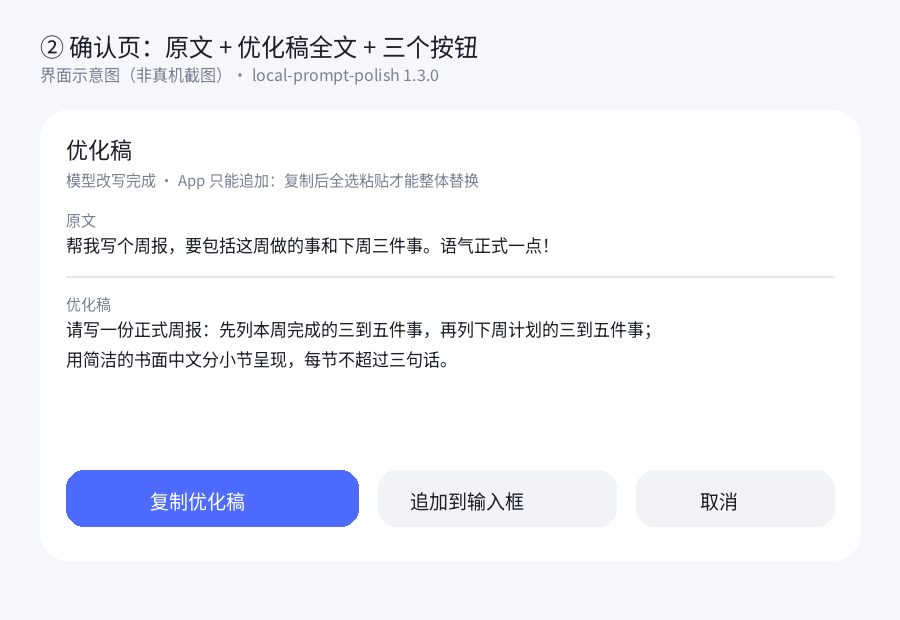
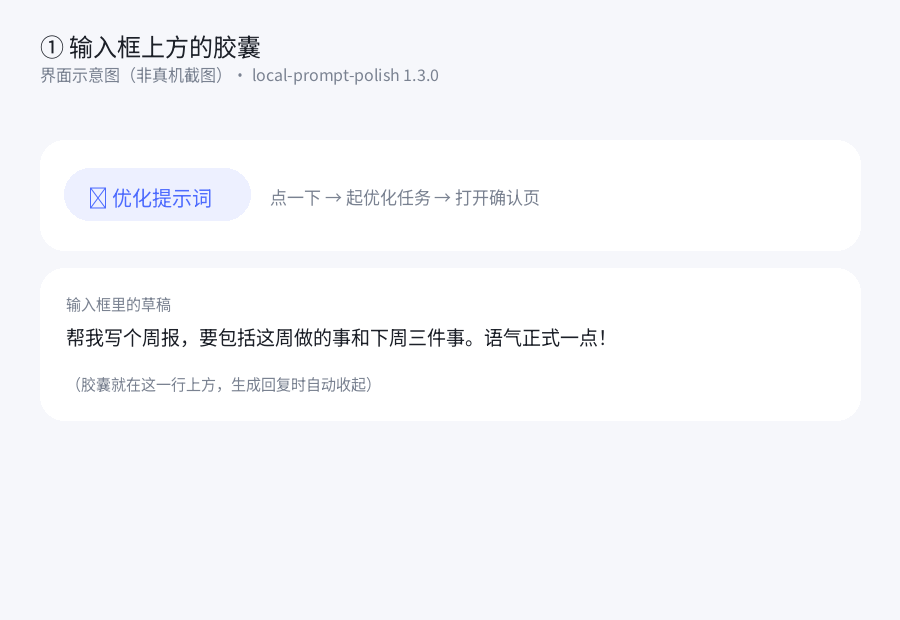

# local-prompt-polish


[](https://github.com/usi112/dsh-go-prompt-polish/actions/workflows/check.yml)

**dsh-go 输入框上方的「✦ 优化提示词」胶囊**：点一下，用**当前会话自己的模型**把草稿改写成一条更清晰的提示词，先在确认页里完整预览，再由你决定怎么落到输入框。

不发送消息 · 不改对话内容 · 不额外联网（只走你已配置的模型）



---

## 目录

- [为什么需要它](#为什么需要它)
- [交互](#交互)
- [为什么没有「一键替换」](#为什么没有一键替换)
- [改写质量：不是续写](#改写质量不是续写)
- [上下文与模型路由](#上下文与模型路由)
- [安装](#安装)
- [兼容性](#兼容性)
- [自测](#自测)
- [常见问题](#常见问题)
- [目录结构](#目录结构)
- [更新日志](#更新日志)

## 为什么需要它

写一句话让模型干活，结果不好，多半不是模型笨，是那句话没写清：目标含糊、背景缺失、输出形式没定。

把「帮我把话说清楚」做成一个常驻的小按钮，比每次自己想“我该怎么问”便宜得多。它读的是**你正在写的这段草稿**，加上**最近几轮对话**，所以知道你在做什么。

## 交互



```
点胶囊 → 起优化任务（3 秒内返回）→ 打开确认页
   · 正在优化…
   · 就绪：原文 + 优化稿全文 + 三个按钮
        [复制优化稿]（主）  [追加到输入框]  [取消]
```

| 按钮 | 效果 | 输入框 |
|---|---|---|
| **复制优化稿** | 只写剪贴板 | 不动；长按输入框 → 全选 → 粘贴 = 整体替换 |
| 追加到输入框 | `insert` | App 的语义是合并，优化稿接在原文后面 |
| 取消 | 仅提示 | 一个字都不动 |


- **预览**：原文与优化稿全文（≤1900 字）
- **可编辑**：不能，面板只有文本组件；要改就在输入框里改
- **光标**：由 App 放在文末，插件无法设置选区
- 空草稿 / 少于 4 个字：只提示，不动输入框

## 为什么没有「一键替换」

dsh-go 原生插件的 effect 白名单只有 `insert` / `copy` / `toast` / `command` / `open` / `link` / `refresh` / `patch`，**没有清空或替换草稿的能力**；App 端把 `insert` 实现成合并进草稿（`insertIntoComposer`，注释写的是 *Into the composer, at the caret*）。

所以插件写进输入框只能是追加，删不掉用户已经输入的字。整体替换目前只能靠「复制 + 全选粘贴」这一步用户手势。

要一键替换，需要 App 端新增 `replace` effect —— 已作为建议提交给 dsh-Go：
[ccch1mneyyy/dsh-Go#1148](https://github.com/ccch1mneyyy/dsh-Go/issues/1148)。等它落地，本插件会先探测能力再用。

## 改写质量：不是续写

草稿被定义为「被改写的对象」：不执行、不回答、不续写；不许以草稿原句开头；不许「原文/改写后」这类标签；优化方向只限“目标 / 背景 / 要求与约束 / 交付形式 / 去歧义”；≤ 草稿 3 倍且 ≤ 600 字。

输出后处理会切掉开头复述草稿的整段（按标点切句、去标点做前缀比对，命中 ≥8 字才算复述）；整段复述 → 判失败，用更严格提示重试一次；仍失败 → 本地整理兜底（去“帮我/麻烦/能不能/please”这类填充、合并重复标点、三句以上分条）。

细节见 [docs/architecture.md](docs/architecture.md)。

## 上下文与模型路由

- **上下文**：同一会话最近 8 条 user/assistant 文本，每条截 320 字，总量 ≤ 1600 字。
- **路由**：当前会话的模型 → 该会话日志里最后一次 `request/header` → 部署默认模型。三级都拿不到，就走本地整理，不发网络请求。

## 安装

```sh
# 1) 放进插件目录
mkdir -p "$DSH_HOME/dsh-go/plugins"
curl -L -o /tmp/p.tgz \
  https://github.com/usi112/dsh-go-prompt-polish/releases/download/v1.3.0/local-prompt-polish-1.3.0.tgz
tar xzf /tmp/p.tgz -C "$DSH_HOME/dsh-go/plugins/"

# 2) 注册进当前 profile（手机本机引擎是 web）
dsh plugin --profile web add "$DSH_HOME/dsh-go/plugins/local-prompt-polish"
```

装完**不用重启**就有胶囊；`lib/` 里的代码改过才要在 App「设置 → 引擎 → 重启引擎」。

卸载：`dsh plugin --profile web remove local-prompt-polish`。

> 需要 dsh ≥ 0.2.1-rc.2、App ≥ 1.0.11（原生插件协议 v1）。

## 兼容性

| 组合 | 结果 |
|---|---|
| dsh 0.2.2-rc.1 · App 1.0.15 · Android 16 | 已实测（胶囊 + 确认页 + 复制/追加/取消） |
| 生成回复进行中 | 胶囊会收起（App 行为），回复结束后可点 |
| 没有可用模型 | 立即返回本地整理稿，不弹等待 |
| 老版本 App（无 panels 能力） | 确认页不出现，插件会退化——建议升级 App |

## 自测

```sh
node --check lib/index.js && node --check lib/polish.js
node test/selftest.mjs        # 47 项断言
```

插件检查器（需要本机装了 dsh-go 的 skill kit）：

```sh
node "$DSH_HOME/skills/dsh-go-plugin/kit/bin/check.mjs" . --load
# → 胶囊 1 · 面板 1；zh/en × chat.panel/session.tab 四个视图都能画
```

自测覆盖：空/过短草稿、只开确认页不改输入框、loading→ready、复制不写回、追加显式写回、取消零写回、无模型立即出本地稿、模型抛错仍有稿，以及用 bridge 自己的 `effects.js` 校验 `open/insert/copy/toast` 形状。

## 常见问题

**点了没反应？** 生成回复期间胶囊会收起；等这一轮结束再点。空草稿或少于 4 个字只会弹提示。

**为什么粘贴后原文还在？** 说明没有先「全选」。长按输入框 → 选「全选」→ 再粘贴，选区会被整体替换。

**优化稿比原文长很多？** 说明模型在扩写。本插件的系统提示禁止续写/复述；如果还遇到，把草稿和输出发 issue，我加样本。

**会不会把我的对话发出去？** 只发给你自己配置的模型（当前会话那个），不经过任何第三方服务；`.log.jsonl` 只记长度和状态，不记文本。

**重启引擎后胶囊没了？** 检查 `dsh plugin --profile web list` 里还有没有 `local-prompt-polish`，以及插件目录是否被删。

## 目录结构

```
local-prompt-polish/
├── package.json          # dshGo 清单：composer.actions 胶囊 + panels 确认页
├── cordis.patch.yml      # 注册进 profile
├── lib/
│   ├── index.js          # 胶囊处理、确认页数据/动作、诊断日志
│   └── polish.js         # 路由解析、上下文抽取、模型改写、复述检测、本地兜底
├── test/selftest.mjs     # 47 项断言
├── docs/architecture.md  # 原理与边界
├── docs/preview/         # 界面示意图
└── market-entry.json     # 插件市场条目
```

## 更新日志

见 [CHANGELOG.md](CHANGELOG.md)。

## License

[MIT](LICENSE)
